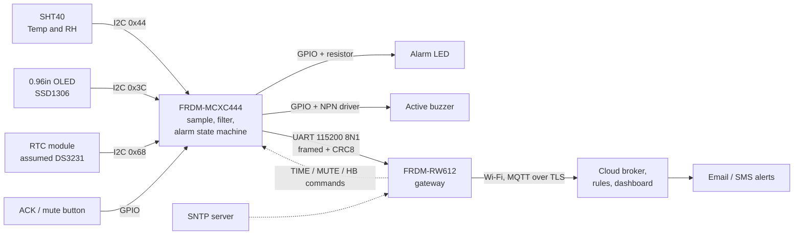

# Medicine Cold-Storage Monitor

A two-board IoT node that watches a medicine fridge (target band **2 °C to 8 °C**), raises a **local alarm** on its own, and uploads telemetry to a **cloud dashboard** that sends **automated email/SMS alerts**.

- **FRDM-MCXC444** is the safety node. It samples the sensor, runs the alarm state machine, and drives the OLED, LED and buzzer. It keeps working with no Wi-Fi.
- **FRDM-RW612** is the Wi-Fi gateway. It validates frames from the node, buffers them through outages, and publishes them over MQTT/TLS.
- **Cloud** stores history, draws the dashboard, and alerts on temperature excursions **and** on missing data.

> Author: Mayur, Dept. of ECE, NMAM Institute of Technology, Nitte
> Status: **design / scaffolding stage.** No firmware is flashed yet. See [Project status](#project-status).

---

## System overview



Design rules that shape everything else:

1. **The local alarm never depends on the network.** The node decides the alarm state itself.
2. **Silence is an alarm.** The cloud alerts when telemetry stops arriving, not only when it is too warm or too cold.
3. **A dead sensor must not look like a healthy fridge.** Sensor, RTC and link faults are reported explicitly.
4. **No data is silently lost.** The gateway buffers while offline and uploads later, so the history stays complete.

## Hardware

| Part | Role |
|---|---|
| NXP FRDM-MCXC444 | Safety node MCU |
| NXP FRDM-RW612 | Wi-Fi gateway |
| 7semi SHT40 breakout (2.54 mm header) | Temperature / humidity, I2C |
| 0.96" OLED display | Local readout and status |
| RTC module with backup coin cell | Timestamps that survive power loss |
| Active buzzer + LED | Local audible / visual alarm |
| Resistors, NPN transistor, push button, jumpers | Drivers and support (see [BOM](hardware/bom.csv)) |

Wiring, resistor values and pin table: [docs/wiring.md](docs/wiring.md).

## Repository layout

```
medicine-cold-storage-monitor/
├── README.md
├── docs/
│   ├── architecture.md     block, sequence and failure-mode diagrams
│   ├── wiring.md           connection diagram, pin table, resistor values
│   ├── state-machine.md    alarm logic, thresholds, hysteresis
│   ├── protocol.md         binary UART frame, messages, CRC, gateway rules
│   ├── cloud.md            MQTT topics, payloads, alert rules, platform options
│   ├── firmware-review.md  what was kept/changed from the supplied firmware package, and why
│   ├── test-plan.md        verification tests with pass criteria
│   └── workflow.md         build phases and git workflow
├── hardware/
│   └── bom.csv             bill of materials
├── firmware/
│   ├── common/             protocol.h/.c: framing, CRC-8, telemetry pack/unpack (portable C)
│   ├── mcxc444/            node: alarm, sht40, ds3231, node_app (portable) + hal_mcxc444.c (stub)
│   └── rw612/              gateway: gw_core, record_queue (portable) + board_rw612.c (stub)
├── cloud/                  example payload, dashboard/rule exports later
└── tests/host/             PC tests and a mock board; run with `make test`
```

## Quick start (what works today)

All logic that does not touch hardware is tested on a PC:

```bash
cd tests/host
make test      # protocol, sensors, alarm, gateway, and a full node simulation
make smoke     # compile-only check of the entry points and board stubs
```

## Project status

| Area | State |
|---|---|
| Architecture, protocol, wiring plan | Drafted |
| Protocol, SHT40/DS3231 maths, alarm state machine, node app, gateway core, queue | Written, **host-tested** |
| MCXC444 hardware layer (`hal_mcxc444.c`: I2C, UART, GPIO, watchdog, OLED) | **Stub, not started** |
| RW612 board layer (`board_rw612.c`: UART, Wi-Fi, SNTP, MQTT/TLS) | **Stub, not started** |
| Cloud dashboard and alert rules | Not started |
| Hardware assembled | Not started |

Open decisions: cloud platform (see [docs/cloud.md](docs/cloud.md)), exact RTC part number, exact pins on both boards (TBD in [docs/wiring.md](docs/wiring.md) until checked against the board user guides).

## Limitations

This is a **demonstration-grade** monitor. It uses a hobby-grade sensor with no calibration certificate, so it must not be described as regulatory compliant (for example WHO or GDP cold-chain requirements). Real deployments need a calibrated, certified probe and validated procedures.

## Roadmap

See [docs/workflow.md](docs/workflow.md) for the phase-by-phase build order.
