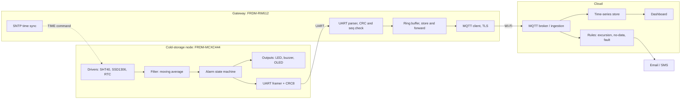
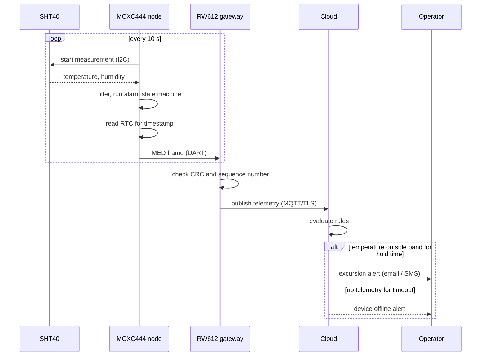

# Architecture

## 1. Block diagram

## 2. Normal telemetry and alert flow

## 3. Time handling

The node timestamps every frame from its RTC so readings keep correct times even if the gateway or Wi-Fi is down.

1. At boot the node reads the RTC and checks its validity (oscillator-stop / power-loss flag).
2. If the time is invalid, the node sets the `RTC` fault bit and sends `epoch = 0`.
3. The gateway gets UTC from SNTP and sends `$CMD,TIME,<epoch>` to the node. The node writes it to the RTC and clears the fault.
4. The gateway repeats the sync periodically (for example every 6 hours) to correct drift.
5. The cloud treats `epoch = 0` frames as "time unknown" and falls back to its own receive time.

## 4. Failure modes and system response

| Failure | Detected by | Node response | Cloud / gateway response |
|---|---|---|---|
| Temperature out of band | Node FSM | LED + buzzer after hold time | Excursion alert |
| Sensor disconnected or I2C error | Node (NACK / CRC) | "SENSOR ERR" on OLED, fault alarm | Fault alert |
| RTC lost power or invalid | Node (flag) | OLED indicator, `epoch = 0` | Time resync via gateway |
| UART frame corrupted | Gateway (CRC) | None | Frame dropped, counter incremented |
| UART frame lost | Gateway (sequence gap) | None | Gap logged in telemetry |
| Gateway silent | Node (missing heartbeat) | OLED shows "NET?" | No-data alert fires |
| Wi-Fi or internet down | Gateway | Local alarm unaffected | Gateway buffers, uploads on reconnect; no-data alert fires meanwhile |
| Cloud unreachable | Gateway (publish failure) | Local alarm unaffected | Same as Wi-Fi down |
| Power cut to the whole node | Cloud (no data) | Node is down, RTC keeps time | No-data alert; gateway on backup power can send a last-gasp event |

## 5. Why two boards

The split is deliberate and worth stating in the report:

- The **node** handles time-critical, safety-relevant work on a small MCU with low power use. It must stay correct even when the network stack is not.
- The **gateway** carries the complex, failure-prone parts (Wi-Fi, TLS, MQTT) so that a crash or reconnect storm there cannot stop the local alarm.
