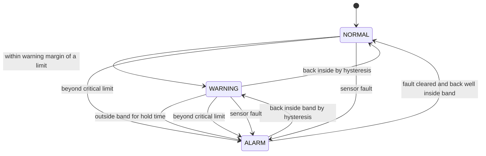

# Alarm State Machine (runs on the MCXC444)

All values below are **starting defaults**. Tune them during testing and record the final numbers in the report.

## Parameters

| Parameter | Default | Meaning |
|---|---|---|
| `SAMPLE_PERIOD` | 10 s | Time between measurements |
| `FILTER_N` | 3 | Moving-average window (30 s) |
| `T_LOW` / `T_HIGH` | 2.0 °C / 8.0 °C | Allowed band |
| `WARN_MARGIN` | 0.5 °C | Warning zone just inside each limit |
| `HYST` | 0.3 °C | Must return this far inside before clearing |
| `ALARM_HOLD` | 120 s | Time outside the band before alarming (ignores door openings) |
| `T_CRIT_LOW` / `T_CRIT_HIGH` | 0.0 °C / 10.0 °C | Immediate alarm, no hold time |
| `NET_TIMEOUT` | 60 s | Heartbeat missing before "NET?" is shown |

## States

| State | Condition | Outputs |
|---|---|---|
| NORMAL | `T_LOW + WARN_MARGIN` ≤ T ≤ `T_HIGH - WARN_MARGIN` | LED off, buzzer off |
| WARNING | Inside the band but within `WARN_MARGIN` of a limit | LED blinking, buzzer off |
| ALARM | Outside the band for `ALARM_HOLD`, or beyond a critical limit, or sensor fault | LED solid, buzzer on until acknowledged |

Acknowledging (local button or `$CMD,MUTE`) silences the buzzer only. The LED stays on and the state stays ALARM until the temperature actually recovers, so a muted alarm is never mistaken for a resolved one.

## Diagram

## Rules that matter

- **Hysteresis** stops the alarm flapping when the temperature hovers near a limit.
- **Hold time** avoids paging someone because the door was open for a minute. The critical limits override it so a real freeze or heat event is immediate.
- **Sensor fault is an alarm.** If the SHT40 NACKs or its CRC fails for 3 consecutive reads, the OLED shows `SENSOR ERR`, the state goes to ALARM, and `fault` bit 0 is set.
- **Latched events.** Each time the state changes, the node sends a frame immediately instead of waiting for the next period.

## Low-power note

The node can sleep between samples (wake from a low-power timer). Keep the OLED, I2C and UART active only around each sample/transmit window. If power use is not a goal in the demo, a simple 10 s timer loop is acceptable; state that choice in the report.
