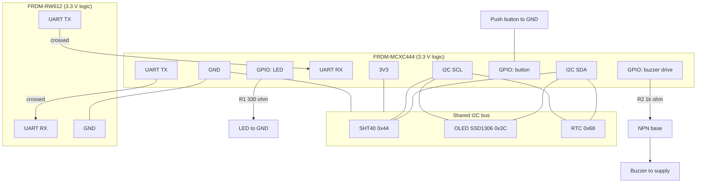

# Wiring and Connections

> **Pin numbers are intentionally marked TBD.** Confirm the I2C, UART and GPIO pins against the FRDM-MCXC444 and FRDM-RW612 user guides and the SDK pin tool before wiring. Do not copy pin names from other FRDM boards.
> All logic is **3.3 V**. Both boards must share **GND**.

> **Pins suggested in the supplied firmware package (UNVERIFIED):** I2C SDA/SCL = PTC0/PTC1, LED = PTD4, buzzer drive = PTD5, button = PTA4, UART TX/RX = PTB17/PTB16. These were not checked against the MCX C444 documents and some may not support the function assumed (for example, whether PTC0/PTC1 can be I2C). Verify each with the SDK pin tool before wiring; treat the table below as TBD until then.

## 1. Connection diagram

## 2. Signal table

| Signal | From | To | Notes |
|---|---|---|---|
| I2C SDA | MCXC444 SDA pin (TBD) | SHT40, OLED, RTC SDA | One shared bus |
| I2C SCL | MCXC444 SCL pin (TBD) | SHT40, OLED, RTC SCL | Keep wires short (30 cm or less) |
| 3V3 | MCXC444 3V3 | SHT40, OLED, RTC VCC | Check each module's rating |
| GND | MCXC444 GND | All modules | Common ground |
| UART TX | MCXC444 UART TX pin (TBD) | RW612 UART RX pin (TBD) | Crossed |
| UART RX | MCXC444 UART RX pin (TBD) | RW612 UART TX pin (TBD) | Crossed |
| GND link | MCXC444 GND | RW612 GND | Required for UART reference |
| LED | MCXC444 GPIO (TBD) | R1 then LED anode, cathode to GND | Active high |
| Buzzer drive | MCXC444 GPIO (TBD) | R2 then NPN base | Active high |
| Button | MCXC444 GPIO (TBD) | One side to GND | Use internal pull-up |

## 3. Expected I2C addresses

| Device | Address | Note |
|---|---|---|
| SHT40 | 0x44 | Common default variant; confirm on your breakout |
| SSD1306 OLED | 0x3C | Some modules use 0x3D |
| DS3231 RTC | 0x68 | Assumes a DS3231 module. Confirm the part you have |

No conflicts. Run an I2C scan first to confirm all three appear.

## 4. Resistors and small parts

| Ref | Value | Purpose |
|---|---|---|
| R1 | 330 Ω | LED current limit, about 4 mA from 3.3 V with a red LED |
| R2 | 1 kΩ | NPN base resistor for the buzzer driver |
| R3 | 10 kΩ (optional) | Base pull-down so the buzzer stays off during reset |
| R4, R5 | 4.7 kΩ (do not fit by default) | I2C pull-ups. Most breakouts already have them; several in parallel make the bus too strong. Measure before adding |
| C1 | 100 nF (optional) | Button debounce across the switch |
| Q1 | NPN, 2N2222 or BC547 | Switches the buzzer so the GPIO is not loaded |
| D1 | 1N4148 (optional) | Flyback diode across the buzzer, for magnetic buzzer types |
| BT1 | CR2032 | RTC backup (usually on the RTC module) |

Notes:

- **Buzzer voltage.** If your active buzzer is rated 3.3 V, power it from 3V3. If it is rated 5 V, power it from the board's 5 V pin through Q1. The 3.3 V GPIO still drives Q1's base fine.
- **RTC backup cell.** Some cheap DS3231 modules try to charge a non-rechargeable CR2032. If yours does, use a rechargeable LIR2032 or remove the charging resistor/diode as described for your module.
- **Sensor placement.** Do not mount the SHT40 right at the fridge door. Put it in a small thermal buffer (a sealed vial of water or glycol) so it tracks product temperature, and keep the breakout away from condensation.
- **Power.** Both boards are powered over USB for the demo. Add a power bank as backup if you want to demonstrate a power-loss event.
