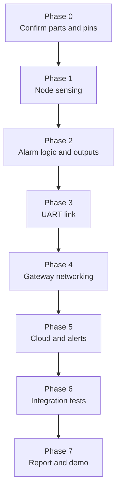

# Project Workflow

## Build phases



| Phase | Work | Exit check |
|---|---|---|
| 0 | Confirm RTC part, read board user guides, fix pin table in `docs/wiring.md`, choose cloud platform | Pin table has no TBD left |
| 1 | I2C bring-up: SHT40, OLED, RTC. Print readings | T01, T02 |
| 2 | Filter, state machine, LED, buzzer, button | T03–T08 |
| 3 | Frame encode on node, parse on gateway, TIME and HB commands | T11, T12 |
| 4 | Wi-Fi, SNTP, MQTT/TLS, ring buffer | T13, T16 |
| 5 | Dashboard, excursion / no-data / fault rules, email (then SMS if feasible) | T14, T15 |
| 6 | Full system tests, including unplug and outage cases | T09, T10, T17 and the full table |
| 7 | Report, block diagrams, test evidence, demo script | Demo runs end to end |

Build in this order. Each phase has a hardware check you can finish before moving on, which keeps debugging isolated to one new part at a time.

## Git workflow

- `main` always contains something that builds or is documentation-only. Work on branches such as `feat/node-sht40`, `feat/gateway-mqtt`, `docs/report`.
- Commit small, with a message that says what changed and why.
- Tag milestones, for example `v0.1-node-sensing`, `v0.2-uart-link`, `v0.3-cloud-demo`.
- Never commit Wi-Fi passwords, MQTT credentials or certificates. Keep them in a local file listed in `.gitignore` and commit a `secrets.example.h` with placeholder values.

## Publishing the repo

```bash
gh repo create medicine-cold-storage-monitor --public --source=. --remote=origin --push
```

Or create an empty repository on GitHub and run `git remote add origin <url>` followed by `git push -u origin main`.
