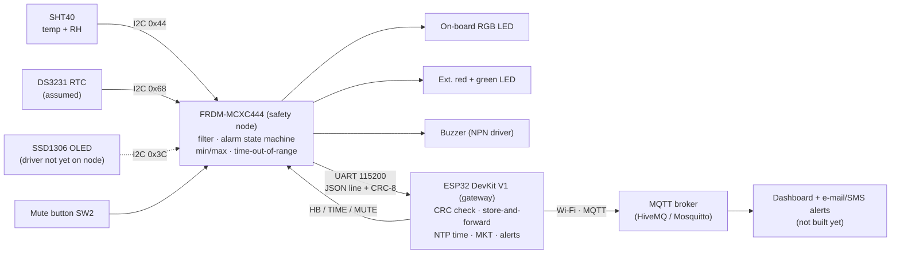

# Medicine Cold-Storage Monitor
 
A two-board IoT monitor for a medicine fridge (target band **2 °C to 8 °C**). It raises a **local alarm on its own**, streams readings to the cloud through an **ESP32 gateway**, and is built so that **silence, a dead sensor and a lost clock are all treated as problems**, not as "everything is fine".
 
> Author: Mayur, Dept. of ECE, NMAM Institute of Technology, Nitte
> Status: **working prototype, partly verified.** Read [Project status](#project-status) before trusting any claim below.
 
---
 
## How it works
 

 
Design rules:
 
1. **The local alarm never depends on the network.** The node decides the alarm state itself.
2. **Silence is an alarm.** The node shows "gateway lost" (blue), and the gateway reports "node silent" and, through the MQTT Last Will, "gateway offline".
3. **A dead sensor must not look like a healthy fridge.** A failed SHT40 read becomes a fault alarm after 3 tries.
4. **No data is silently lost.** The gateway queues readings while Wi-Fi/MQTT is down and uploads them in order afterwards. Corrupted lines are dropped and counted, never published.
## What the LEDs and buzzer mean
 
| Situation | On-board RGB LED | External red LED | External green LED | Buzzer |
|---|---|---|---|---|
| Normal (inside band, away from limits) | **Green**, solid | off | **on** | off |
| Warning (near a limit, or outside but inside the hold time) | **Yellow**, blinking | blinking | off | off |
| **Alarm** (outside band for the hold time, or beyond 0 °C / 10 °C) | **Red**, solid | solid | off | **on** until muted |
| Alarm, muted by button or remote command | Red, solid | solid | off | off (re-arms after 15 min) |
| **Sensor fault** (SHT40 not answering) | **Red, fast blink** | solid | off | on until muted |
| Gateway link lost (any of the above) | **+ Blue** added (cyan = normal + link lost) | | | |
| Power-up lamp test | all colours + short chirp for ~0.8 s | on | on | chirp |
 
A muted alarm stays red. Muting silences the buzzer only; it never hides the fault.
 
## Hardware and wiring
 
| Part | Role |
|---|---|
| NXP FRDM-MCXC444 | Safety node |
| ESP32 DevKit V1 | Wi-Fi/MQTT gateway |
| 7semi SHT40 breakout | Temperature / humidity, I2C 0x44 |
| DS3231 RTC module + CR2032 | Timestamps that survive power loss (part number still to be confirmed) |
| 0.96" SSD1306 OLED | Display, I2C 0x3C (works on the ESP32; no node driver yet) |
| Red LED + green LED + 2 × 330 Ω | External output monitoring |
| Active buzzer, 2N2222/BC547, 1 kΩ | Audible alarm |
| Push button (on-board SW2 is used) | Mute / acknowledge |
 
| Signal | Node pin | Goes to | Status |
|---|---|---|---|
| I2C SCL / SDA | PTC1 / PTC2 (I2C1, ALT2) | SHT40, RTC, OLED | **Verified on hardware** |
| UART TX | PTE0 (LPUART1, ALT3) | ESP32 GPIO16 (RX2) | TX **verified**, RX new |
| UART RX | PTE1 (LPUART1, ALT3) | ESP32 GPIO17 (TX2) | New, not yet run |
| Common ground | GND | ESP32 GND | Required |
| RGB LED | R = PTE31, G = PTD5, B = PTE29 | on board | From board docs; **polarity assumed active-low** |
| External red LED | PTD3 (Arduino D2) | 330 Ω → LED → GND | From pin listing, unverified |
| External green LED | PTA12 (Arduino D3) | 330 Ω → LED → GND | From pin listing, unverified |
| Buzzer drive | PTC4 | 1 kΩ → NPN base | From pin listing, unverified |
| Mute button | PTC3 (on-board SW2) | internal pull-up | From board docs, unverified |
 
All logic is **3.3 V**. Full details, resistor values and notes: [docs/wiring.md](docs/wiring.md). Every pin lives in one file, [`board_pins.h`](firmware/mcxc444/include/board_pins.h), so a wrong pin is a one-line fix.
 
## Quick start
 
### 1. Run the tests on your PC (no hardware needed)
 
```bash
cd tests/host
make test    # 7 suites: protocol, sensors, alarm, link, gateway logic, RW612 gateway (legacy), full node simulation
make smoke   # compile checks, including the board layer and the ESP32 sketch against stand-in headers
```
 
### 2. Build and flash the node (MCUXpresso)
 
1. Use the MCUXpresso project files from the `frdm` branch (see [firmware/mcxc444/README.md](firmware/mcxc444/README.md)); point its sources at `firmware/mcxc444/src/*.c`, `firmware/common/protocol.c` and add `firmware/mcxc444/include` and `firmware/common` to the include path.
2. Build, flash, and watch the lamp test (all LEDs + chirp), then a green RGB LED.
3. For a quick demo, build with `-DNODE_ALARM_HOLD_S=20` so the alarm trips after 20 s instead of 120 s.
### 3. Flash the ESP32 gateway (Arduino IDE)
 
1. Install the **PubSubClient** library.
2. In `firmware/esp32_gateway/cold_gateway/`, copy `secrets.example.h` to `secrets.h` and fill in Wi-Fi and broker details (`secrets.h` is git-ignored).
3. Open `cold_gateway.ino`, flash, and open the Serial Monitor at 115200.
### 4. Watch it arrive
 
```bash
mosquitto_sub -h <broker-ip> -t 'nitte/lab/node1/#' -v          # everything
mosquitto_pub -h <broker-ip> -t 'nitte/lab/node1/cmd' -m mute   # remote mute
```
 
HiveMQ's web client works the same way: subscribe to `nitte/lab/node1/#`.
 
## Data
 
Topics under `nitte/lab/node1/`:
 
| Topic | Content |
|---|---|
| `data` | One reading per 10 s (JSON below). `"buf":1` marks readings uploaded after an outage |
| `alert` | `state_change`, `fault_change` and `node_silent` events |
| `status` | Gateway `online` / `offline` (retained; `offline` is the MQTT Last Will) |
| `node` | Node `ok` / `silent` (retained) |
| `cmd` | You publish `mute` or `sync` here |
 
Example `data` message (field values are illustrative):
 
```json
{"v":2,"seq":1042,"ep":1794096000,"up":10420,"t":4.45,"tf":4.47,"h":61.20,"st":0,"f":0,"m":0,
 "min":3.98,"max":5.12,"tor":0,"alm":0,
 "stn":"NORMAL","buf":0,"gw":1794096001,"mkt":4.51,"crcerr":0,"gaps":0,"rst":0}
```
 
| Field | Meaning |
|---|---|
| `ep` | UTC time from the node's RTC (0 = RTC invalid; the gateway then sets it from NTP) |
| `t` / `tf` | Calibrated reading / 30 s moving average used by the alarm logic (°C) |
| `st` / `stn` | 0 NORMAL, 1 WARNING, 2 ALARM |
| `f` | Fault bits: 1 sensor, 2 RTC, 4 OLED, 8 gateway link |
| `m` | 1 = buzzer muted |
| `min` / `max` / `tor` / `alm` | Since node boot: lowest, highest, seconds outside 2–8 °C, alarms raised |
| `mkt` | Rolling 24 h **Mean Kinetic Temperature** computed by the gateway |
| `gw` | Gateway UTC when it handled the line |
| `crcerr` / `gaps` / `rst` | Link health: bad lines dropped, lost lines, node resets |
 
The wire format and commands are specified in [docs/protocol.md](docs/protocol.md).
 
## Does it meet cold-medicine storage criteria?
 
**Short answer: the original `frdm` firmware did not, and this version covers the monitoring logic but is not yet a complete or compliant system.** The `frdm` branch was a sensor bring-up (read SHT40 + RTC once a second, print, forward). It had no alarm, no outputs and no fault handling. Full criterion-by-criterion table: [docs/criteria-audit.md](docs/criteria-audit.md). In brief:
 
| Criterion | Before | Now |
|---|---|---|
| Alarm outside 2–8 °C with door-open tolerance and critical limits | missing | implemented, host-tested |
| Local audible + visual alarm independent of Wi-Fi | missing | implemented (hardware untested) |
| Dead sensor detected as a fault | missing | implemented, host-tested |
| Full date + time stamps, RTC fault detection | time only, no date | UTC epoch, fault flagged, NTP resync |
| Data integrity on the link | none | CRC-8 + sequence numbers |
| No data loss across Wi-Fi/MQTT outages | gateway blocked and dropped | 20-minute RAM queue |
| Silence detected | none | node silent / gateway offline |
| Min/max, time out of range, MKT | none | implemented |
| Calibration against a reference | none | offset constant, **ice-bath test still to do** |
| E-mail/SMS alerts, long-term records | none | **not built** |
| Power-loss backup, secured transport | none | **not built** |
 
## Repository layout
 
```
README.md
docs/            architecture, wiring, protocol, state machine, cloud, test plan, workflow, criteria audit
hardware/        bom.csv
firmware/
  common/          protocol.h/.c (CRC-8, enums; also the legacy binary frames)
  mcxc444/         node: alarm, link, sht40, ds3231, node_app (portable) + hal_mcxc444.c (board)
    bringup/         the original hardware-verified SHT40 + DS3231 + UART bring-up program
  esp32_gateway/
    cold_gateway/    gateway sketch + gw_logic.h (testable logic) + secrets.example.h
  rw612/           earlier FRDM-RW612 gateway design (superseded by the ESP32, kept for reference)
cloud/             example payloads
tests/host/        PC tests, mock board, stand-in SDK/Arduino headers for compile checks
```
 
## Project status
 
| Area | State |
|---|---|
| SHT40 + DS3231 on FRDM-MCXC444 over I2C1, UART to ESP32 | **Verified on hardware** (earlier bring-up) |
| ESP32 → Wi-Fi → MQTT broker, values seen in HiveMQ | **Verified** with the first gateway version |
| Alarm state machine, link format, gateway logic, MKT | Written, **host-tested** (7 PC suites) |
| Node board layer (LEDs, buzzer, button, UART receive, SysTick) | **Written, never run on hardware** |
| New ESP32 gateway sketch (queue, NTP, alerts, commands) | **Written, syntax-checked only, never run** |
| OLED on the node | Not started (works on the ESP32 test sketch) |
| Watchdog | Code present, **off by default**, untested |
| Dashboard, alert rules, e-mail/SMS | Not started |
| Calibration, test evidence (photos, logs) | Not started |
 
## Known limitations
 
- The SDK I2C call has **no timeout**: a stuck bus can hang the node. The watchdog is the mitigation and is off until its behaviour is confirmed on the board.
- UART receive on the node is polled, not interrupt-driven. Commands are short, CRC-protected and repeated, so loss is tolerated but not impossible.
- MQTT delivery is QoS 0. The queue covers outages, not messages lost on the wire while connected; `seq` exposes such gaps.
- The local broker is unauthenticated plain MQTT. Fine for a lab bench, not for a deployment.
- Statistics (`min`, `max`, `tor`, `alm`) are kept in RAM and reset when the node reboots.
- Pin assignments marked "unverified" must be checked against the board schematic before wiring LEDs.
## Limitations
 
This is a **demonstration-grade** monitor. It uses a hobby-grade sensor with no calibration certificate, so it must not be described as regulatory compliant (for example WHO or GDP cold-chain requirements). Real deployments need a calibrated, certified probe, validated procedures, power backup and secured, audited data storage.
 
